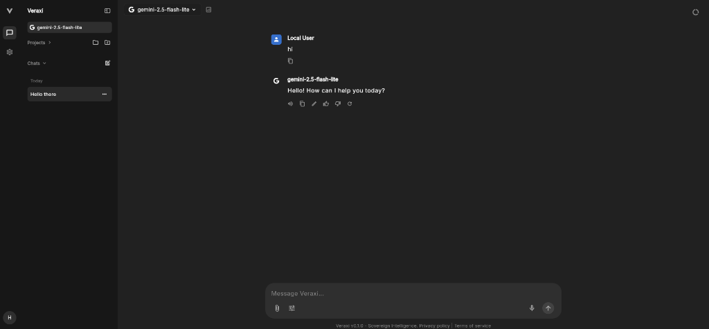

# Veraxi

Veraxi is a reference architecture for **Hybrid GraphRAG** that combines a knowledge graph (Neo4j) with dual vector search (Qdrant with MiniLM dense + SPLADE sparse embeddings) and fuses results via Reciprocal Rank Fusion (RRF). 

It gives LLMs autonomous, tool-based access to both relational topology and semantic context over the Model Context Protocol (MCP), eliminating hallucinations on complex multi-hop queries. The engine is written in FastAPI/Python and the client is a cross-platform Flutter application.

## 🌐 Live Demo & Endpoints
- **Frontend (Flutter Web):** [https://veraxi.me](https://veraxi.me)
- **Backend API (FastAPI):** Google Cloud Run
- **Interactive Documentation:** `http://localhost:8000/docs`



## Why Hybrid GraphRAG? (The Architectural Tradeoff)

Standard Vector RAG retrieves text chunks based solely on mathematical proximity (cosine similarity). This frequently collapses on multi-hop questions where synthesizing truth requires connecting facts across non-adjacent documents—the "Similarity Trap", where distracting chunks outscore the actual truth.

**Hybrid GraphRAG** addresses this by extracting and traversing hard relational edges alongside vector similarity:
```
[Elena Rostova] ──(FOUNDED)──▶ [Acme AI] ──(ACQUIRED_BY)──▶ [GlobalTech] ──(DEPLOYS)──▶ [Veraxi]
```

By querying deterministic graph edges and semantic vector embeddings simultaneously, the LLM retrieves the exact isolated facts required to resolve multi-hop queries without hallucination.

### ⚠️ Scope & Architectural Boundaries
While Veraxi includes multi-tenancy, JWT auth, Stripe billing scaffolds, and GPT-SoVITS TTS integration, **these are structural boilerplates for developers**. Veraxi's primary value is serving as an integration reference of the Neo4j + Qdrant RRF pipeline wired into an end-to-end user application.

---

## ⚡ Just-In-Time (Lazy) GraphRAG Architecture

Traditional GraphRAG pipelines (such as Microsoft GraphRAG) extract every noun and relation upfront using expensive LLM calls, creating cost traps ($50–$200 per book) and producing dense "hairballs" of noisy sentence-level co-occurrences (`MENTIONED_WITH`, `WORKS_FOR`).

Veraxi eliminates this with a **Two-Tier Just-In-Time Pipeline**:

1. **Tier 1 — Base Ingestion & Cross-Document Linking (CPU-Optimized, Free):**
   * Raw text (PDFs, Markdown, text files) is chunked and indexed into Qdrant using dual embeddings: **MiniLM (dense semantics)** and **SPLADE (lexical keywords)**.
   * Lightweight entity anchors are resolved across documents using **acronym and suffix normalization** (e.g., matching "WHO" ↔ "World Health Organization", "Apple Inc." ↔ "Apple").
   * Multi-document provenance is maintained with **bidirectional UUID links** (`qdrant_point_ids` list ↔ `neo4j_node_ids`).
   * Ingestion runs at **under 2 minutes per 500-page book** on pure CPU with 0 GPU VRAM.

2. **Tier 2 — On-Demand Causal Graph Weaving (Just-In-Time):**
   * When an agent researches a topic or complex multi-hop question, seed chunks are retrieved via `mcp_build_lazy_dossier`.
   * The model extracts high-precision, verified **causal relationships** and commits them via `mcp_insert_graph_nodes`.
   * The knowledge graph grows organically into a curated knowledge base without upfront API bills.

---

## 🤖 Dual Execution Modes: Fast vs. Deep Research

Veraxi separates high-throughput conversational chat from deep investigative research:

1. **Fast Mode (Standard Chat):**
   * Powered by a single chat model loop with sub-second to 2s streaming via SSE.
   * Answers general, conversational, and direct questions with minimal latency and minimal token consumption.
   * Invokes internal tools (`mcp_search_vectors`, `mcp_query_graph`) only when context is required.

2. **Deep Research Mode (Multi-Agent Swarm):**
   * Powered by a specialized LangGraph state machine (`mcp_agentic_debate`).
   * Dispatches concurrent specialist subagents:
     * **Vector Specialist:** Dual dense + SPLADE sparse retrieval from Qdrant.
     * **Graph Specialist:** Entity relationship and multi-hop graph traversal from Neo4j.
     * **Web Specialist:** Live web search and ephemeral web indexing.
   * **Synthesizer & Writer:** Fuses multi-modal context into structured reports with strict inline bracketed citations (`[Vector Source X]`, `[Graph Relation X]`, `[Web Source X]`).
   * **Skeptic Node:** An adversarial judge evaluating mathematical claim grounding (`mcp_evaluate_grounding`). Ungrounded claims trigger an iterative revision loop back to the Writer (up to 3 rounds).

---

## 🛠 Quickstart (Local Development)

You can run the entire storage stack locally for free via Docker and connect to free cloud LLM models (Gemini, Groq) or local models (Ollama).

### 1. One-Command Setup
```bash
git clone https://github.com/kcoaguila-dev/veraxi.git
cd veraxi

# Copies .env templates and installs venv + pre-commit
make setup

# Starts Neo4j, Qdrant, Redis, and SearXNG with healthy startup probes
make up

# Seeds local Neo4j & Qdrant with synthetic multi-hop test data (0 API keys needed)
make seed
```

### 2. Resource Usage & Low-RAM Tuning
By default, the local Neo4j Docker container is constrained to prevent the JVM from consuming all available host RAM:
- `NEO4J_HEAP` (default `512m`)
- `NEO4J_PAGECACHE` (default `256m`)

Users on budget hardware can adjust these values in `docker-compose.yml` or via environment variables before running `make up`. To find the optimal memory settings for your specific machine, you can run:
```bash
docker run --rm neo4j:5 neo4j-admin server memory-recommendation --memory=<RAM> --docker
```

**BYOD Cloud Instances:** For a near-zero local RAM footprint, you can point `NEO4J_URI` to a free Neo4j AuraDB instance and `QDRANT_URL` to a free Qdrant Cloud instance. Set these environment variables before starting the backend, and local databases won't be necessary.

### 3. Service Dashboards
Once `make up` completes:
- **FastAPI OpenAPI Swagger:** [http://localhost:8000/docs](http://localhost:8000/docs)
- **Neo4j Browser UI:** [http://localhost:7474](http://localhost:7474) *(user: `neo4j`, pass: `changeme_local_password`)*
- **Qdrant Dashboard:** [http://localhost:6333/dashboard](http://localhost:6333/dashboard)
- **SearXNG Search Engine:** [http://localhost:8080](http://localhost:8080)

### 4. Run the Backend & Frontend
```bash
# Start backend natively with hot-reload
make run-backend

# In a separate terminal, launch the Flutter desktop client (Linux/macOS/Windows)
cd app
flutter run -d linux
```

---

## 🧰 Developer CLI (`vx`)

Veraxi includes a dedicated, zero-dependency developer CLI (`vx`) for terminal knowledge retrieval and agent alignment:

| Command | Purpose |
| :--- | :--- |
| `vx chat` | Interactive terminal knowledge assistant with slash shortcuts (`/web`, `/fetch`, `/trace`, `/stats`, `/models`). |
| `vx config` | Inspect, set, or unset configuration values (`api_url`, `api_key`, `model`) with safe secret masking and `--json` support. |
| `vx models` | Discover supported multi-provider models (OpenAI, Anthropic, Gemini, Groq, DeepSeek, Ollama), verify API key readiness, and switch default model. |
| `vx doctor` | Inspects system environment (Android Termux, Linux, macOS), MCP endpoint reachability, and client configs (Claude Code, Cursor, Cline). |
| `vx web search "<q>"` | Zero-dependency live web search via DuckDuckGo (CLI & `--json`). |
| `vx web fetch <url>` | Clean Markdown/text webpage extraction for AI agents and Termux. |
| `vx trace "<entity>"` | Traces multi-hop causal paths in the terminal across Neo4j nodes. |
| `vx stats` | Displays live counts of nodes, vectors, and relationships for the current tenant. |
| `vx rules sync` | Synchronizes active architectural constraints to `CLAUDE.md`, `.cursorrules`, and `.clinerules`. |
| `vx review` | 1-Command Git diff auditor and CI architectural rule enforcer. |

### 🛠 Makefile Developer Shortcuts

| Target | Purpose |
| :--- | :--- |
| `make install-cli` | Installs the lightweight `vx` developer CLI globally. |
| `make seed` | Populates local Neo4j and Qdrant with interrelated multi-hop seed data in 3 seconds. |
| `make inspect-mcp` | Launches the interactive `@modelcontextprotocol/inspector` against the `/sse` endpoint. |
| `make lint` / `make format` | Runs unified linters (`ruff` and `flutter analyze`) across both codebases. |

### ⚡ 1-Line Universal Installer

Install `vx` on Linux, macOS, or Android (Termux) with zero hassle:

```bash
curl -fsSL https://raw.githubusercontent.com/kcoaguila-dev/veraxi/main/install.sh | bash
```

### 📱 Android (Termux) Support

The `vx` CLI is architected using **100% Pure Python standard library** (0 C-extensions, 0 compiled Rust wheels, 0 glibc dependencies). Unlike heavy AI packages that fail to build on Android's `bionic` C runtime, `vx` installs in under 3 seconds on Termux and runs natively on ARM64/aarch64:

```bash
# In Termux on Android:
pkg update && pkg install -y python git
curl -fsSL https://raw.githubusercontent.com/kcoaguila-dev/veraxi/main/install.sh | bash

# Run diagnostics and start chatting with your knowledge base from mobile:
vx doctor
vx chat
```

*(Optional) Run `pkg install termux-api` to enable mobile clipboard integration (`termux-clipboard-set`).*

---

## 🛠 Core Model Context Protocol (MCP) Tools

Veraxi exposes its hybrid engine over standard MCP endpoints (`/sse`):

### MCP tool profiles
The exact set of tools exposed via MCP depends on the `VERAXI_MCP_PROFILE` environment variable (defaults to `agent`):
- `agent`: The default profile. Exposes a streamlined, safe set of tools needed for autonomous research, deep search, and ingestion (`mcp_merge_rank`, `mcp_search_vectors`, `mcp_query_graph`, `mcp_evaluate_grounding`, `mcp_web_search`, `mcp_ephemeral_web_rag`, `mcp_agentic_debate`, `mcp_ingest_document`, `mcp_get_ingest_status`, `mcp_get_database_stats`).
- `admin` (or `all`): Exposes all available tools. This profile is required for the `ingest_knowledge` / manual graph-editing workflow and raw CRUD operations.

| Tool | Purpose |
| :--- | :--- |
| `mcp_merge_rank` | **[DEFAULT - Fast (<100ms)]** Primary hybrid GraphRAG search: Qdrant dense + sparse vectors combined with Neo4j multi-hop traversals via Reciprocal Rank Fusion (RRF). Entity name is optional. |
| `mcp_search_vectors` | **[FAST - Vector Only (<50ms)]** Semantic vector search over document chunks. Ideal for fast text similarity retrieval without graph traversals. |
| `mcp_query_graph` | **[FAST - Graph Only (<50ms)]** Multi-hop causal relationship and entity path traversal in Neo4j from a known entity. |
| `mcp_agentic_debate` | **[HEAVY - Long Running (15-30s)]** High-accuracy GraphRAG research debate. Dispatches Vector, Knowledge Graph, and Web specialists with strict citations and an adversarial Skeptic verification loop. |
| `mcp_ephemeral_web_rag` | **[WEB RAG - Moderate (3-8s)]** Crawls external web URLs, dynamically ingests them into an ephemeral sandboxed knowledge graph and vector space, and returns fused RRF facts. |
| `mcp_build_lazy_dossier` | Retrieves ground-truth excerpts via Hybrid Search (Dense + SPLADE) fused with Neo4j entity anchors, returning a structured analytical dossier. |
| `mcp_insert_graph_nodes` | Upserts/merges structured causal entities and rich relations into Neo4j, preserving Qdrant vector links without duplicates. |
| `mcp_purge_noisy_relationships` | Purges uncurated co-occurrence edges from Neo4j for a tenant while keeping all entity nodes and vector links intact. |
| `mcp_get_database_stats` | Live counts of nodes, vectors, and relationships for the current tenant. |
| `mcp_export_data` | Exports structured timelines and research into CSV, OpenTimelineIO (`.otio`), or Final Cut Pro XML (`.fcpxml`). |

---

## 📚 Batch Document Ingestion

To ingest folders of books, 10-K filings, or research PDFs in bulk using the CPU-optimized pipeline:
```bash
python -m backend.scripts.batch_ingest --dir /path/to/documents --tenant <tenant_id> --fast --chunk-size 600 --chunk-overlap 100
```

See [docs/architecture.md](docs/architecture.md) for a deep dive into the dependency flow and design rules.

---

## 📊 Evaluation & Benchmarks

Veraxi includes an automated [DeepEval](https://github.com/confident-ai/deepeval) benchmark suite that scores Vector RAG against Hybrid GraphRAG on a medical test corpus (`backend/evaluation/benchmark_rag.py`).

**Evaluation Infrastructure:**
- A 2,062-question pipeline (`run_full_suite.sh`) and a zero-cost deterministic 150-question pipeline (`run_deterministic_suite.sh`) are committed in `backend/evaluation`.
- Deterministic evaluations use stratified sampling and token-overlap (ROUGE-1) to bypass LLM-as-a-judge API costs.
- To execute the full benchmark against live models:
  ```bash
  PYTHONPATH=. python -m backend.evaluation.benchmark_rag
  ```

---

## Contributing
See [CONTRIBUTING.md](CONTRIBUTING.md).

## License
MIT — see [LICENSE](LICENSE).
